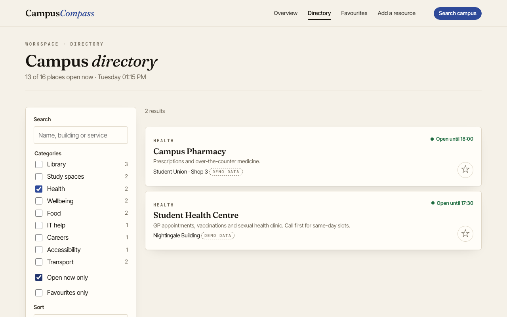
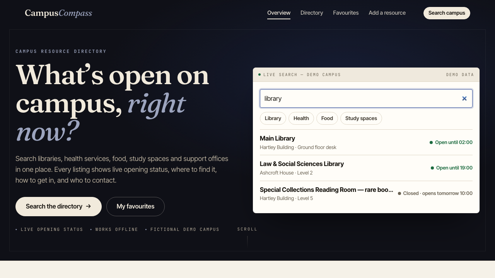
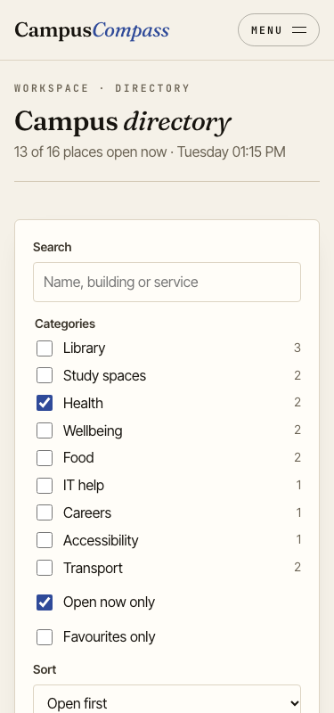

# Campus Compass

A searchable directory of campus resources — libraries, study spaces, health, wellbeing, food, IT help, careers, accessibility and transport — with live opening status, location and access details, contacts and favourites.



| Landing | Mobile |
| --- | --- |
|  |  |

## Run it

```bash
npm install
npm run dev        # http://localhost:5109
npm test
npm run build
npm run test:e2e   # Playwright smoke test (npm run e2e:install once if Chromium is missing)
```

## Main workflow

1. **Directory** → search by name, building or service; tick categories; “Open now only”; favourites only; sort open-first or A–Z. A result count is announced to screen readers.
2. Each card shows live status (“Open until 22:00”, “Closes soon · 17:30”, “Closed · opens tomorrow 09:00”, “Open 24 hours”).
3. Open a place → weekly hours with today highlighted, building, room, accessibility notes, phone and email (missing values are stated, not hidden).
4. Star places → **Favourites**.
5. **Add a resource** → validated form (email/phone format, distinct open/close times, at least one day). A closing time earlier than opening means “closes after midnight”.

Demo data: 16 places at a fictional “Demo University” with fictional `.example` contacts, including 24-hour places, a library that closes at 2 am, a market open only on Fridays, a service with no contact details and a very long name. Each card is labelled “Demo data”.

## Tests

- `src/lib/campus.test.ts` — open/closing/closed labels, next opening (today, tomorrow, weekday), hours past midnight, 24-hour detection, filtering, validation.
- `src/App.test.tsx` — search + category + open-now with a fixed clock, no-match state, favourites, adding a past-midnight resource.
- `e2e/smoke.spec.ts` — fixed Tuesday 13:15 clock: hero search, filter, detail, favourite, reload; strict 375px checks.

## Limitations

- Uses the device's local time; no time-zone selection for remote campuses.
- No map; locations are text only.
- Holiday and term-time hours are not modelled.
- Added resources live only in this browser and cannot be edited yet.

## Future improvements

- Exceptions calendar (holidays, term breaks), an embeddable campus map, and editing of user-added places.
